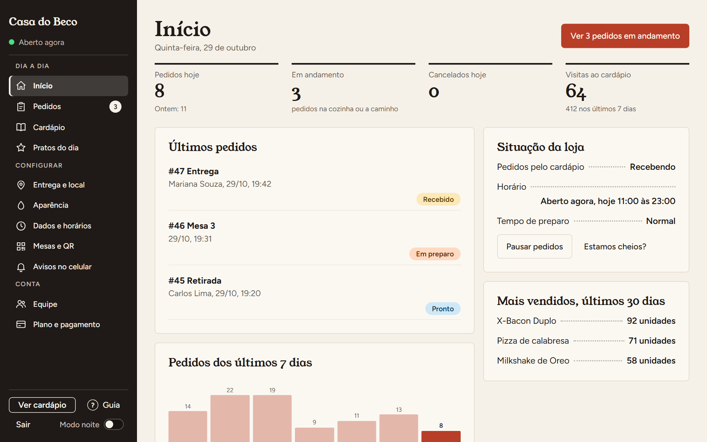
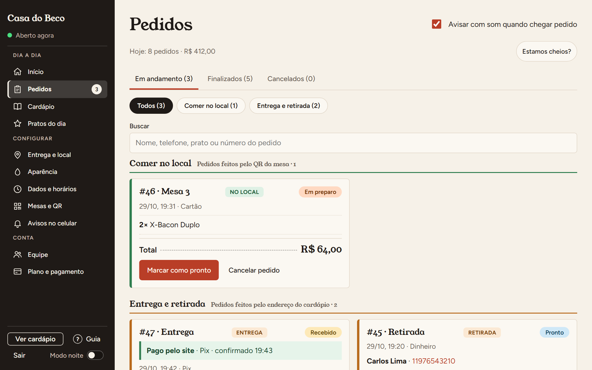
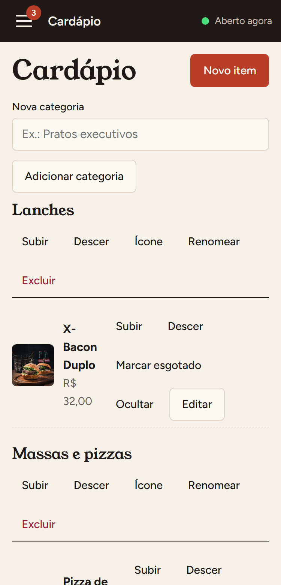
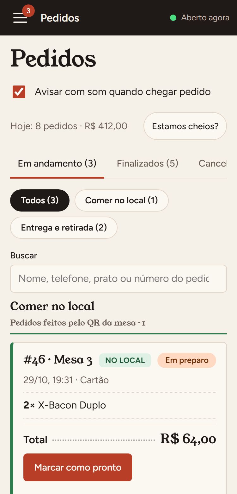

# Gumori: Cardápio Online

**Cardápio digital multi-tenant para restaurantes:** pedidos na mesa por QR code, retirada e entrega com frete por distância. Demonstração: [cardapio-online-agendacom.vercel.app](https://cardapio-online-agendacom.vercel.app).

> O código-fonte fica em repositório privado por ser um produto comercial. Posso mostrar o sistema funcionando e o código em uma entrevista.

## Funcionalidades

- **Pedido na mesa via QR code**, retirada e entrega
- **Frete por faixa de distância:** a distância por ruas é calculada pelo OSRM, e o banco confere o valor contra a linha reta para impedir fraude
- **Pratos do dia:** promoção por intervalo de datas, com preço antigo riscado
- **Adicionais e escolhas obrigatórias** (tamanho, ponto), com valor extra por opção
- **Painel do restaurante** com pedidos em tempo real e aviso sonoro
- **Notificações push** de pedidos novos com o site fechado (Web Push, inclusive no iPhone via PWA)
- **Super admin:** teste grátis, cobrança de mensalidade, pausa e exclusão de estabelecimentos, com log de auditoria
- **Imagens otimizadas:** fotos convertidas para WebP no navegador antes do upload

## Stack

| Camada | Tecnologia |
|---|---|
| Frontend | React, TypeScript, Vite |
| Backend | Supabase: PostgreSQL com RLS, Auth, Storage, Realtime, Edge Functions |
| Geolocalização | OpenStreetMap/Nominatim (endereço), OSRM (rota), Google Maps embed |
| Testes | Vitest e testes de banco em Postgres em memória (regras e segurança) |
| CI/CD | GitHub Actions + Vercel |

## Como o sistema foi pensado

- **Preço nunca vem do cliente:** preço, frete e total são recalculados no banco (`place_order`) a cada pedido.
- **Frete protegido:** o cardápio público não expõe as faixas de frete; a cotação só é feita depois que o cliente informa o endereço.
- **Testes de segurança no banco:** o banco é reconstruído a partir de todas as migrations e as políticas RLS são testadas automaticamente.
- **Exclusão segura:** nenhum estabelecimento é apagado de forma automática; o super admin precisa digitar o endereço para confirmar.

## Telas

**Painel do restaurante**

**No celular**

  
  

